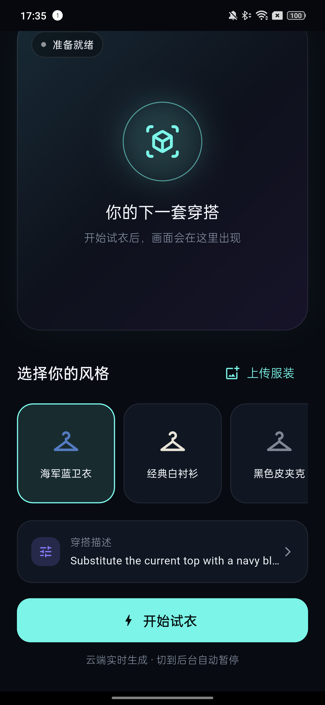
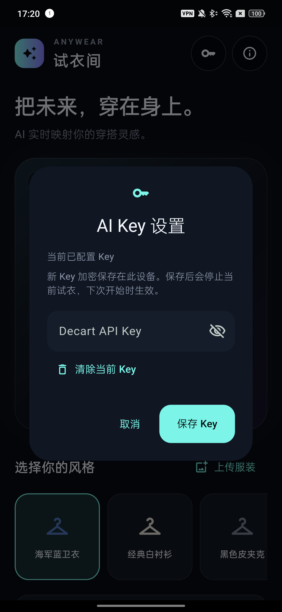

# 试衣间 · Flutter Android / iOS

[English README](README.en.md) · [GitHub 发布与上传指南](docs/github-publishing.md) · [安全策略](SECURITY.md)

当前界面采用深色 OLED 画布、青绿主色、紫色辅助色和轻量玻璃卡片，参考现代 iOS 应用常见的留白、层级和沉浸式媒体布局。实时试衣后，视频右上角的按钮可以进入沉浸式全屏；左上角按钮退出全屏，并恢复竖屏和系统栏。

应用图标以服装、闪光和取景框表达智能试衣。Android 使用自适应图标，iOS 使用对应尺寸的图标目录；图标源文件位于 `assets/branding/`，可使用安装了 `sharp` 的 Node.js 运行 `node tool/generate_app_icons.cjs` 重新生成两端资源。

基于 Decart Lucy VTON 实时试衣接口开发的双端 MVP。它是一套独立 Flutter 客户端，不是官方 Anywear Chrome 插件的源码转换，也不包含云端模型权重。

当前验证：29 项 Flutter 测试通过，静态分析无问题；Android 真机和 iOS 原生构建记录见 `VALIDATION.md`。iOS 原生构建已使用 Xcode 26.1.1 / Swift 6.2.1 在 GitHub Actions 通过无签名 debug 编译。

## 截图





截图来自 Android 真机 debug 构建；实际视频画面、延迟和费用取决于你的 Decart 账户、网络和设备。

## 已实现

- 支持简体中文、繁体中文（台湾）和英文，Android / iOS 原生视频渲染；简体中文设备使用简体，台湾繁体设备使用繁体，其他语言默认英文。Android 桌面名称和 iOS 应用名称、相机/照片权限提示也已随语言本地化。
- 相册上传服装图片、四种本地化预设、自定义本地化穿搭描述，并启用 Decart 描述增强。
- 实时视频试衣、查看原相机、前后摄像头切换。
- 首次开启前告知云端视频处理，并请求系统相机权限。
- 切到后台自动停止；返回后由用户重新开始，避免自动恢复计费。
- 连接中停止、权限拒绝、网络错误和超大图片处理。
- 开发版在顶部钥匙图标更换测试 Key，加密保存在设备；发布环境使用服务端临时凭据。

## 工具与平台

| 项目 | 要求 |
| --- | --- |
| Flutter / Dart | Flutter 3.44+ / Dart 3.12+；当前工程验证版本见 VALIDATION.md |
| Android | Android 7 / API 24+，Java 17，AGP 9；SDK 36+ |
| iOS | iOS 17+，Mac + Swift 6.2.1+ 工具链（如 Xcode 26.1+），Swift Package Manager |
| 设备 | 实时相机试衣需真机；iOS 模拟器无法验证相机 |

`pubspec.yaml` 已在项目级启用 Swift Package Manager，无需修改全局 Flutter 设置。Decart iOS SDK 要求 Swift 6.2.1+，请使用 Xcode 26.1.1 或更高版本；若机器安装了多个 Xcode，构建前选择对应版本：

```bash
sudo xcode-select --switch /Applications/Xcode-26.1.1.app/Contents/Developer
```

## Riverpod 状态管理

使用 `flutter_riverpod 3.4.3`、`riverpod_annotation 4.0.7` 和 `riverpod_generator 4.0.9`，通过 `build_runner 2.15.1` 生成 Provider。注解和生成器使用与 Riverpod 3.4.3 匹配的官方版本，它们的主版本号不与运行库同步。

- `lib/providers/app_providers.dart`：集中提供配置、加密存储、相机权限、登录令牌和 Decart 网关依赖，测试通过 `override` 替换。
- `lib/features/try_on_state.dart`：不可变的试衣状态，包含连接、描述、服装、计时和提示信息。
- `lib/features/try_on_controller.dart`：生成的 Notifier 处理试衣操作；自动取消 SDK 事件订阅，网关 Provider 在不再使用时释放原生资源。异步操作在写回状态前检查对应 Ref 是否仍有效。
- `lib/features/api_key_settings.dart`：生成的 AsyncNotifier 加载并更新 Key 配置状态；实际 Key 留在 `DevelopmentKeyStore`，不会成为 UI 状态。开始试衣会等待加密存储加载完成。
- `TryOnPage` 和 Key 对话框通过 `ref.watch` 渲染、`ref.read(...notifier)` 执行操作。全屏、输入框和临时选择状态保留在 Widget 内。

入口使用 `ProviderScope`，不再手工创建或向页面传递控制器。修改 Provider 后运行：

```bash
dart run build_runner build
# 开发时持续生成
dart run build_runner watch
```

生成的 `.g.dart` 与源码一起保留；本地检查脚本和 CI 均先生成代码，CI 还检查已提交的生成文件是否同步。测试使用 `ProviderContainer.test` 和 `ProviderScope` 覆盖真实依赖。

## 本地运行

安装匹配的 Flutter SDK，在工程根目录执行：

```bash
flutter pub get
dart run build_runner build
cp config/development.example.json config/local.json
```

在本机编辑 `config/local.json`，填入自己 Decart 账户的临时测试 Key。该文件已加入 `.gitignore`，不要把真实 Key 发到聊天或提交到仓库。

### 申请 Decart Key

1. 打开 [Decart 控制台](https://decart.ai)，注册或登录账号。
2. 在控制台的 API Keys / Developers 页面创建一个用于本地调试的临时 Key。页面名称可能随 Decart 更新，请以控制台当前界面为准。
3. 将以 `dct_` 开头的 Key 写入本机的 `config/local.json`，或在应用顶部的钥匙图标中输入。不要把 Key 写进 Dart、Kotlin、Swift、截图、Issue 或公开日志。
4. 调试结束或怀疑泄露时，立即在 Decart 控制台撤销并重新生成。实时试衣会消耗账户额度，先设置额度和请求限制。

`config/development.example.json` 只有占位符；`config/local.json` 和 `config/production.json` 已被忽略。发布版本应使用自己的后端签发短期凭据，永久 `dct_` Key 只能放在服务端，详见[服务端接入](#接入服务端)和 [SECURITY.md](SECURITY.md)。

```bash
flutter devices
flutter run -d <Android或iPhone设备ID> --dart-define-from-file=config/local.json
```

开发 Key 仅在 debug 构建有效。也可不填写配置文件中的 Key，先打开界面，再通过顶部钥匙图标进入「AI Key 设置」，粘贴新 Key 并保存。保存会停止当前试衣，下次点击「开始试衣」时使用新 Key；新 Key 加密保存在设备，重启后保留。设置中保存的值优先于构建配置；点击「清除当前 Key」后不会恢复旧的预置 Key。发布版继续使用服务端临时凭据，不显示测试 Key 设置。

「穿搭描述」和预设会跟随界面语言显示为简体中文、台湾繁体中文或英文；点击描述卡片即可编辑服装颜色、材质和版型。描述会原样提交给 Decart 并启用描述增强，实际试衣效果以模型返回为准。

语言由系统首选语言在应用启动时解析：`zh-CN` 和简体中文映射到 `zh`，`zh-TW` 或繁体中文脚本映射到 `zh-TW`，其他语言映射到 `en`。本地化源文件位于 `lib/l10n/app_*.arb`，修改后运行 `flutter gen-l10n` 生成 Dart 目录；Riverpod Provider 修改后运行 `dart run build_runner build`。

iPhone 首次真机运行还需要在 Xcode 打开 `ios/Runner.xcworkspace`，选择自己的开发 Team 和唯一 Bundle ID。仓库已移除上游示例的签名 Team。

## 接入服务端

手机用 HTTPS 请求你自己的 `POST /api/realtime-token`，服务端保管永久 `dct_` Key，并返回短期 JWT（也兼容旧式 `ek_` 凭据）：

```json
{"apiKey":"<服务端签发的短期 JWT>","expiresAt":"2026-12-01T00:00:00Z"}
```

将 `config/production.example.json` 复制为 `config/production.json`，修改接口地址。接入已有账户体系时，覆盖 `lib/providers/app_providers.dart` 中的 `accessTokenProvider`，从当前用户会话取得短期登录令牌。不要把登录凭据或永久 Decart Key 写入发布包。

```dart
ProviderScope(
  overrides: [
    accessTokenProvider.overrideWithValue(
      () => yourAuthService.currentAccessToken(),
    ),
  ],
  child: const FittingRoomApp(),
)
```

`backend/token_server.py` 提供无需第三方依赖的私有联调示例：必须设置 `DECART_API_KEY` 和 `APP_SESSION_TOKENS` 环境变量，默认只监听 `127.0.0.1:8080`。它验证测试用户的 Bearer 凭据、每用户每分钟最多签发六次，并把单次云端会话限制为 120 秒。通过自己的 HTTPS 反向代理接入手机。

仅在 debug 联调配置里可添加 `APP_SESSION_TOKEN`，对应服务端允许的一个测试会话。生产版本须替换这个测试会话白名单为真实用户登录、额度和撤销机制；客户端的 provider 接口已预留。示例服务不是完整用户管理系统。

## 构建与检查

```bash
dart run build_runner build
flutter analyze
flutter test
python3 -m unittest discover -s backend -v
flutter build apk --debug
flutter build ios --debug --no-codesign
```

配置服务和签名后再生成分发版本：

```bash
flutter build appbundle --release --dart-define-from-file=config/production.json
flutter build ipa --release --dart-define-from-file=config/production.json
```

当前 Android release 仍使用模板的 debug 签名，需在正式分发前配置自己的上传密钥。当前 Bundle ID 为 `com.example.fitting_room` / `com.example.fittingRoom`，也需要替换。iOS debug 构建已完成无签名验证；真机运行仍需在 Xcode 中配置开发 Team 和唯一 Bundle ID。

## 源码与授权

本项目使用 [MIT License](LICENSE)，允许他人复制、修改、商用和再发布，但需要保留版权及许可证文本。Decart 商标、API、模型和账户服务仍受 Decart 当前条款约束。

- Flutter 封装：<https://github.com/Emmanueloluwadamilola/decart-flutter-sdk>
- 引入版本：1.0.1，commit `a3cf919ecfaff3742eb076146156d8aa9b18b663`，MIT。源码放在 `packages/decart_vton_flutter`，保留原授权文件。
- 本地修正：兼容 Decart 当前返回的 JWT 临时凭据；Android 采用 Flutter 3.44 的 KGP 兼容配置。升级 Flutter 时需重新核对其内置 Kotlin 支持。
- 官方试衣示例：<https://github.com/DecartAI/tryon-examples>。
- 原生 SDK 固定 Android 0.7.10 / iOS 0.6.10，以匹配封装 API。
- 官方试衣文档：<https://docs.platform.decart.ai/models/realtime/virtual-try-on>。
- 当前普通实时试衣公开价格为 $0.02 / 活跃生成秒，费用以账户和官方最新报价为准：<https://docs.platform.decart.ai/getting-started/pricing>。

已用用户提供的测试 Key 验证 Decart 临时凭据接口，实际设备验证结果见 `VALIDATION.md`。真实 Key 不包含在源码交付包中。商品链接抓图、系统分享导入、衣柜历史、登录支付和录制保存尚未纳入第一版。
